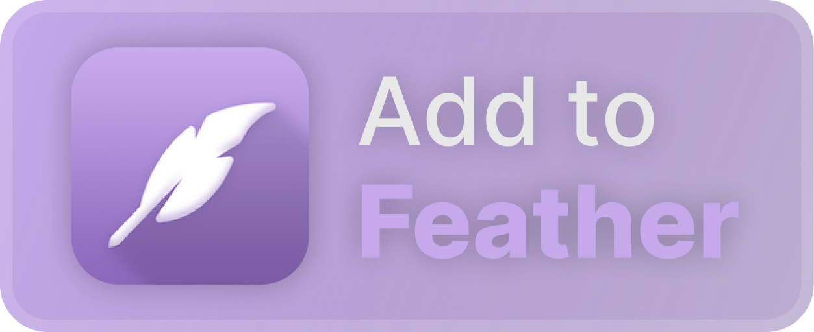

# @unbound-app/loader

[](https://github.com/unbound-app/loader-ios/actions/workflows/build.yml)
[](https://github.com/unbound-app/loader-ios/actions/workflows/android.yml)

Native loaders that inject [Unbound](https://github.com/unbound-app/client) into Discord on iOS and Android. They also give addons the native APIs they need. Both platforms share one C++ core, so the bundle updater, addon loading, settings and JS bridge behave identically on each.

## Layout

| Path        | What it is                                                                                           |
| ----------- | ---------------------------------------------------------------------------------------------------- |
| `core/`     | Shared C++20 core: settings store, addon scanning, preload script, bundle updater, load pipeline, `NativePlatform` JSI bridge, native plugin async runtime |
| `ios/`      | The Theos tweak (ElleKit, rootless) plus the iOS app extensions                                       |
| `android/`  | The LSPosed module (modern libxposed API) and its NDK library, built with Gradle                     |
| `resources/`| The shared bootstrap scripts (`modules.js`, `devtools.js`) used by both platforms                     |
| `tools/`    | Go build tooling for the iOS packages, IPAs and attestation                                          |

## Installation

### iOS

Builds are in the [Releases](https://github.com/unbound-app/loader-ios/releases/latest) tab.

**Jailbroken:** add the apt repo <https://repo.unbound.rip> to your package manager, or install the `.deb` directly.

**Jailed:** add <https://repo.unbound.rip/app-repo.json> to your sideloading tool, or install [Unbound.ipa](https://github.com/unbound-app/loader-ios/releases/latest/download/Unbound.ipa).

<div>
    <a href="https://intradeus.github.io/http-protocol-redirector?r=sidestore://source?url=https://repo.unbound.rip/app-repo.json"></a>
    &nbsp;
    <a href="https://intradeus.github.io/http-protocol-redirector?r=feather://source/https://repo.unbound.rip/app-repo.json"></a>
    &nbsp;
    <a href="https://intradeus.github.io/http-protocol-redirector?r=altstore://source?url=https://repo.unbound.rip/app-repo.json"></a>
    &nbsp;
    <a href="https://github.com/unbound-app/loader-ios/releases/latest/download/Unbound.ipa"></a>
</div>

> [!WARNING]
> Non-ElleKit tweak runtimes will likely break functionality. When sideloading, use the pre-patched IPA.

### Android

**Rooted (LSPosed/Vector):** install `Unbound-Android-<version>.apk`, enable the module, and scope it to `com.discord`.

**Not rooted:** install the pre-patched `Unbound-Discord-<version>.apks`, which is Discord with the module embedded through LSPatch. Use a split-APK installer such as SAI. It replaces an existing Play Store Discord because the signature differs.

Both artifacts are produced by the [Build Android](https://github.com/unbound-app/loader-ios/actions/workflows/android.yml) workflow.

## Feature parity

| Feature                                   | iOS | Android |
| ----------------------------------------- | :-: | :-----: |
| Bundle injection, updater, rollback       | ✅  | ✅      |
| Plugins, themes and fonts preloaded        | ✅  | ✅      |
| `NativePlatform` bridge                    | ✅  | ✅      |
| Font overrides                             | ✅  | ✅      |
| Theme colors on native views               | ✅  | ✅      |
| Safe Mode toggle from the home screen      | ✅  | ✅ (launcher shortcut) |
| Sentry blocking                            | ✅  | ✅      |
| Dev server auto-detection (vphone / emulator) | ✅ | ✅    |
| Live reload (HMR)                          | ✅  | Not yet |
| `NativePlugin` addon bridge                | ✅ (`objc`, `ffi`, `fabric`) | Not yet (`java` namespace) |
| Debug toolbox, dev overlay, chat UI tweaks | ✅  | Not yet |

## Building

<details>
<summary>Shared core</summary>

```bash
cmake -S core -B build/core -DUNBOUND_CORE_TESTS=ON
cmake --build build/core
ctest --test-dir build/core --output-on-failure
```

</details>

<details>
<summary>iOS</summary>

> These steps assume macOS.

1. Install Xcode, then `brew install make ldid`, and put GNU make first on your path:

```bash
export PATH="$(brew --prefix make)/libexec/gnubin:$PATH"
```

2. Install [Theos](https://theos.dev/docs/installation-macos):

```bash
bash -c "$(curl -fsSL https://raw.githubusercontent.com/theos/theos/master/bin/install-theos)"
```

3. Clone the repository with its submodules, then build from the repository root:

```bash
go run ./tools build tweak --configuration debug
go run ./tools build all
```

`go run ./tools doctor` checks host dependencies. Pass `--ipa /path/to/Discord.ipa` when building IPAs, and `--simulator` for the simulator archive. The tweak can also be built with `make package` inside `ios/`. Packages are written to `ios/packages/`.

Repository-dispatched builds use the `DKRYPT_API_KEY` Actions secret to fetch decrypted IPAs. The remote-deploy workflow defaults to `https://ipa.dylib.dev`; set `DKRYPT_BASE_URL` to use another dkrypt deployment.

</details>

<details>
<summary>Android</summary>

Requires JDK 17+, the Android SDK with platform 36, NDK `27.3.13750724` and CMake `3.22.1`.

```bash
cd android
./gradlew :module:assembleRelease
```

The module APK is written to `android/module/build/outputs/apk/release/`. To produce a non-root build, embed it into Discord's split APKs with [LSPatch](https://github.com/JingMatrix/LSPatch):

```bash
java -jar lspatch.jar base.apk config.*.apk -m module-release.apk -l 2 -o patched
```

</details>

## Development

### Live reload (HMR)

1. Run the client's dev server (`bun run serve` in `packages/client`). It serves the bundle and a Server-Sent Events stream at `/__hot`.
2. Set `loader.update.url` to the dev server, e.g. `http://<your-LAN-ip>:3000/`, and `loader.update.hmr` to `true`.
3. Launch Discord. Every rebuild re-fetches the bundle and reloads the app. This is iOS-only for now; on Android, relaunch Discord to pick up a new build.

On the iOS vphone and the Android emulator, the loader finds a dev server on the host automatically when `loader.update.url` is unset. On the emulator, that host is reached at `10.0.2.2:3000`.

### Debugger

Point `debugger.address` at a running `ub-debugger` bridge to evaluate JavaScript on a device. The emulator reaches the host at `10.0.2.2`.

## Contributors

[](https://github.com/unbound-app/loader-ios/graphs/contributors)
